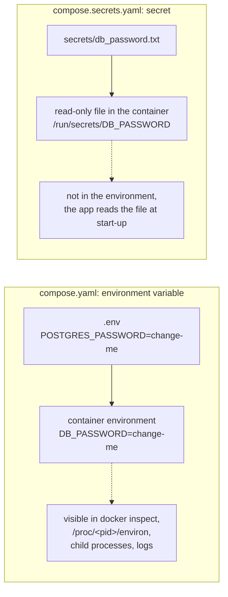
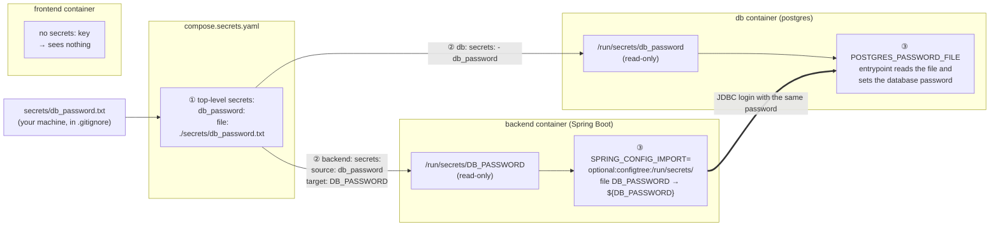
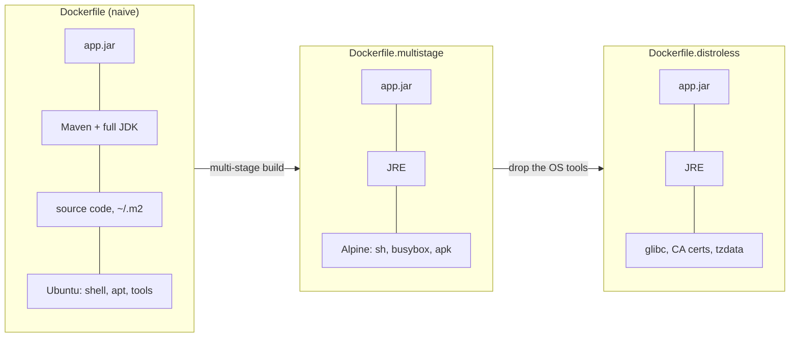

# Docker Playground

A hands-on repo for learning Docker with a realistic three-tier app: a **Vue.js** frontend, a **Spring Boot** (Maven) REST API and a **PostgreSQL** database, each running in its own container.

The app is a small **ticketing system**:

| Role      | Users (password `password`) | Can do                                                        |
|-----------|-----------------------------|---------------------------------------------------------------|
| **USER**  | `alice`, `bob`              | create tickets, see / edit / delete **their own** OPEN tickets |
| **AGENT** | `agent`                     | see **all** tickets, assign a ticket to themselves, resolve it |

```
                 ┌──────────────────────┐      ┌──────────────────────┐      ┌──────────────┐
 browser ──────► │ frontend             │ /api │ backend              │ JDBC │ db           │
  :8081          │ nginx + Vue (static) │ ───► │ Spring Boot :8080    │ ───► │ PostgreSQL   │
                 └──────────────────────┘      └──────────────────────┘      └──────────────┘
```

## Repository structure

| Path                              | What it is                                                              |
|-----------------------------------|-------------------------------------------------------------------------|
| [`.devcontainer/`](.devcontainer) | Dev container / GitHub Codespaces with Docker, JDK 25, Maven and Node 24 |
| [`backend/`](backend)             | Spring Boot API: entities, repositories, services, Spring Security, Swagger, tests. See [backend/README.md](backend/README.md) |
| [`frontend/`](frontend)           | Vue 3 + Vite single-page app with Vitest tests. See [frontend/README.md](frontend/README.md) |
| [`compose.yaml`](compose.yaml)    | Starts the whole stack (db + backend + frontend) with one command        |
| [`compose.secrets.yaml`](compose.secrets.yaml) | Same stack, but the DB password is passed as a Compose **secret** (section 5) |
| [`compose.distroless.yaml`](compose.distroless.yaml) | Override file: builds the backend from `Dockerfile.distroless` (section 7) |
| [`.env.example`](.env.example)    | Template for `.env` (DB credentials, ports) used by Compose              |

Each component has **two Dockerfiles** so you can compare them:

| File                    | Idea                                                                                   |
|-------------------------|----------------------------------------------------------------------------------------|
| `Dockerfile`            | The *naive* version: one stage, runs as **root**, ships build tools and source code    |
| `Dockerfile.multistage` | The *better* version: **multi-stage** build, **non-root** user, layer caching, healthcheck |
| `Dockerfile.distroless` | Backend only: like multistage, but the runtime image is **distroless** (no shell, no package manager). See section 7 |

---

## 1. Environment setup

Choose **one** of the options.

### Option A — Dev container / GitHub Codespaces (recommended)

Everything (Docker, JDK, Maven, Node) is pre-installed.

- **Codespaces:** on GitHub click **Code → Codespaces → Create codespace on main**.
- **VS Code locally:** install Docker (see option B) and the *Dev Containers* extension, open the folder and choose **Reopen in Container**.

The dev container uses *docker-in-docker*: there is a full Docker engine **inside** the container, so `docker build`, `docker run` and `docker compose` work as on a normal machine. Ports 8080, 8081 and 5173 are forwarded automatically.

Check it:

```bash
docker version
docker compose version
java -version && mvn -v && node -v
```

### Option B — Install Docker on your machine

#### Linux — Ubuntu / Debian

Install Docker Engine from Docker's official apt repository (the `docker.io` package in the distro is usually older):

```bash
# remove old/unofficial packages (it's fine if none are installed)
for pkg in docker.io docker-doc docker-compose podman-docker containerd runc; do sudo apt-get remove -y $pkg; done

# add Docker's GPG key and repository
sudo apt-get update
sudo apt-get install -y ca-certificates curl
sudo install -m 0755 -d /etc/apt/keyrings
sudo curl -fsSL https://download.docker.com/linux/ubuntu/gpg -o /etc/apt/keyrings/docker.asc
sudo chmod a+r /etc/apt/keyrings/docker.asc
echo "deb [arch=$(dpkg --print-architecture) signed-by=/etc/apt/keyrings/docker.asc] \
  https://download.docker.com/linux/ubuntu $(. /etc/os-release && echo "${UBUNTU_CODENAME:-$VERSION_CODENAME}") stable" \
  | sudo tee /etc/apt/sources.list.d/docker.list > /dev/null

# install engine, CLI, buildx and the compose plugin
sudo apt-get update
sudo apt-get install -y docker-ce docker-ce-cli containerd.io docker-buildx-plugin docker-compose-plugin
```

> On **Debian** replace `linux/ubuntu` with `linux/debian` in both URLs.

#### Linux — Fedora

```bash
sudo dnf -y install dnf-plugins-core
sudo dnf config-manager addrepo --from-repofile https://download.docker.com/linux/fedora/docker-ce.repo
sudo dnf install -y docker-ce docker-ce-cli containerd.io docker-buildx-plugin docker-compose-plugin
sudo systemctl enable --now docker
```

#### Linux — Arch / Manjaro

```bash
sudo pacman -S docker docker-buildx docker-compose
sudo systemctl enable --now docker
```

#### Linux — post-installation (all distros)

Run Docker without `sudo` by adding yourself to the `docker` group, then log out and back in (or run `newgrp docker`):

```bash
sudo usermod -aG docker $USER
newgrp docker
```

> Being in the `docker` group is effectively root access on the machine. That is fine on your own laptop, but not on a shared server.

#### macOS

Install **Docker Desktop** from <https://docs.docker.com/desktop/setup/install/mac-install/> (pick Apple silicon or Intel), or with Homebrew:

```bash
brew install --cask docker
```

Start *Docker* from Applications once so it can finish its setup.

#### Windows

1. Enable WSL 2: open PowerShell **as Administrator** and run `wsl --install`, then reboot.
2. Install **Docker Desktop** from <https://docs.docker.com/desktop/setup/install/windows-install/> and keep **Use WSL 2 based engine** checked.
3. Run the commands in this README from a WSL terminal (e.g. Ubuntu) for the best experience.

#### Verify the installation

```bash
docker version            # client and server (engine) versions
docker compose version    # compose v2 plugin
docker run --rm hello-world
```

---

## 2. Docker in 2 minutes

| Concept       | Meaning                                                                          |
|---------------|----------------------------------------------------------------------------------|
| **Image**     | A read-only template (filesystem + metadata), built from a `Dockerfile`          |
| **Container** | A running instance of an image, with its own process, filesystem and network     |
| **Registry**  | A place where images are stored (Docker Hub, `ghcr.io`, ...)                     |
| **Volume**    | Persistent storage that outlives a container (we use one for PostgreSQL data)    |
| **Network**   | Containers on the same user-defined network reach each other **by name**         |

Commands you will use all the time:

```bash
docker images                         # list images
docker ps / docker ps -a              # running / all containers
docker logs -f <container>            # follow logs
docker exec -it <container> sh        # shell inside a running container
docker stop <container> && docker rm <container>
docker system df                      # disk usage
docker system prune                   # clean up stopped containers, dangling images, ...
```

---

## 3. Walkthrough: one container at a time

We first run everything by hand with `docker run`, so you can see what Compose automates later.

### 3.1 Create a network

Containers on a **user-defined** network can reach each other by container name (built-in DNS):

```bash
docker network create tickets-net
```

### 3.2 PostgreSQL

```bash
docker volume create tickets-db-data

docker run -d --name tickets-db --network tickets-net \
  -e POSTGRES_DB=tickets -e POSTGRES_USER=tickets -e POSTGRES_PASSWORD=tickets \
  -v tickets-db-data:/var/lib/postgresql \
  -p 5432:5432 \
  postgres:18-alpine

docker logs -f tickets-db       # wait for "database system is ready to accept connections", then Ctrl+C
docker exec -it tickets-db psql -U tickets -c '\l'
```

`-p 5432:5432` is only needed if you want to run the backend **outside** Docker (`mvn spring-boot:run`) or connect with a DB client.

### 3.3 Backend — naive Dockerfile vs. multi-stage Dockerfile

```bash
cd backend

# Step 1: naive image
docker build -t tickets-backend:naive .

# Step 2: multi-stage, non-root image
docker build -f Dockerfile.multistage -t tickets-backend:multistage .

docker images | grep tickets-backend
```

Run the better one on the same network. `DB_HOST=tickets-db` is the **container name** of PostgreSQL:

```bash
docker run -d --name tickets-backend --network tickets-net \
  -e DB_HOST=tickets-db \
  -p 8080:8080 \
  tickets-backend:multistage

curl http://localhost:8080/actuator/health
curl -u alice:password http://localhost:8080/api/tickets
```

Swagger UI: <http://localhost:8080/swagger-ui.html> (click **Authorize** and log in as `alice` / `password` or `agent` / `password`).

Who is the process running as?

```bash
docker exec tickets-backend id      # uid=100(spring) ... -> not root
docker run --rm tickets-backend:naive id   # uid=0(root)
```

Details: [backend/README.md](backend/README.md).

### 3.4 Frontend

```bash
cd ../frontend
docker build -t tickets-frontend:naive .
docker build -f Dockerfile.multistage -t tickets-frontend:multistage .

docker run -d --name tickets-frontend --network tickets-net \
  -e BACKEND_URL=http://tickets-backend:8080 \
  -p 8081:8080 \
  tickets-frontend:multistage
```

Open <http://localhost:8081> and log in as `alice`, `bob` or `agent`.

Details: [frontend/README.md](frontend/README.md).

### 3.5 Compare the images

Sizes measured on linux/amd64 (yours may differ slightly):

| Image                          | Size        | Runs as             | Contains                              |
|--------------------------------|-------------|---------------------|---------------------------------------|
| `tickets-backend:naive`        | **~1 GB**   | root                | Maven, full JDK, sources, `~/.m2` cache, jar |
| `tickets-backend:multistage`   | **~420 MB** | `spring` (uid 100)  | Alpine + JRE + jar                    |
| `tickets-frontend:naive`       | **~1.8 GB** | root                | Node, `node_modules`, sources, Vite dev server |
| `tickets-frontend:multistage`  | **~90 MB**  | `nginx` (uid 101)   | nginx + built static files            |

Things to try:

```bash
docker history tickets-backend:multistage      # see the layers
# change a .java file, rebuild both images and compare the build time:
# the multi-stage build reuses the cached dependency layer
```

### 3.6 Clean up

```bash
docker rm -f tickets-frontend tickets-backend tickets-db
docker network rm tickets-net
docker volume rm tickets-db-data      # deletes the database data!
```

---

## 4. Docker Compose: the whole stack with one command

[`compose.yaml`](compose.yaml) describes the same three containers, their network, the volume, environment variables and the start-up order (`depends_on` + healthchecks). It builds the images from the `Dockerfile.multistage` files.

```bash
cp .env.example .env               # first time only: DB credentials and ports (see section 5)
docker compose up --build          # foreground, Ctrl+C to stop
docker compose up -d --build       # in the background
docker compose ps                  # status (incl. health)
docker compose logs -f backend     # logs of one service
docker compose exec db psql -U tickets   # shell into a service
docker compose down                # stop and remove containers (data volume is kept)
docker compose down -v             # ... and delete the database volume
```

| URL                                      | What                     |
|------------------------------------------|--------------------------|
| <http://localhost:8081>                  | Vue frontend             |
| <http://localhost:8080/swagger-ui.html>  | Swagger UI (backend)     |
| <http://localhost:8080/actuator/health>  | Backend health           |

Compose creates a network called `tickets_default`, and each **service name** (`db`, `backend`, `frontend`) is the hostname on it. That is why the backend uses `DB_HOST: db` and the frontend uses `BACKEND_URL: http://backend:8080`.

### `docker compose` or `docker-compose`?

- **`docker-compose`** (with a hyphen) is **Compose v1**, a separate Python program. It has been deprecated since 2023 and no longer receives updates.
- **`docker compose`** (with a space) is **Compose v2**, written in Go and installed as a Docker CLI plugin (`docker-compose-plugin`, included in Docker Desktop). Use this one.
- The file name changed the same way: **`compose.yaml`** is the preferred name in the [Compose Specification](https://compose-spec.io/). `docker-compose.yml` still works. The top-level `version:` key is obsolete and can be removed.

### Why is there an nginx in the frontend container?

It is not strictly required, but it is the usual way to serve a Vue app in production:

1. `npm run build` produces **static files** (HTML/JS/CSS). They need a web server. Running the Vite dev server in production (what the naive `Dockerfile` does) is slow, heavy (~1.8 GB) and not meant for production.
2. nginx also acts as a **reverse proxy**: the browser calls `/api/...` on the same origin, and nginx forwards it to `backend:8080`. This avoids **CORS** configuration, and the backend does not need to be reachable from the browser.

nginx is part of the **frontend image** (see [frontend/Dockerfile.multistage](frontend/Dockerfile.multistage)), so it is *not* a separate service in `compose.yaml`. In a bigger setup you might add a dedicated reverse proxy (nginx, Traefik, Caddy) in front of everything. In Kubernetes that job is done by an Ingress controller.

---

## 5. Environment variables and configuration

The rule: **build the image once, configure it at start-up.** No address or password is written into an image. The same image runs on your laptop, in Compose and later in Kubernetes, with different environment variables.

### Where variables come from

| Mechanism | Example in this repo | Applies |
|---|---|---|
| `ENV` in a Dockerfile | `ENV BACKEND_URL=...` (frontend), `ENV JAVA_TOOL_OPTIONS=...` (backend) | a **default** stored in the image, can be overridden |
| `ARG` in a Dockerfile | (not used) | **build time only**, not present in the running container |
| `docker run -e` / `--env-file` | `docker run -e DB_HOST=tickets-db ...` | container start |
| Compose `environment:` | `DB_HOST: db`, `BACKEND_URL: http://backend:8080` | container start |
| Compose `env_file:` | (not used) | container start, values loaded from a file |
| `.env` next to `compose.yaml` | `POSTGRES_PASSWORD=change-me` | fills `${VAR}` placeholders **in compose.yaml itself** |

When the same variable is set in several places, Compose `environment:` wins over `env_file:`, which wins over the image's `ENV`. A default inside the app (e.g. `${DB_HOST:localhost}` in Spring) is used only if none of them sets it.

Look at the variables of a running container:

```bash
docker compose exec backend printenv | grep DB_
docker inspect tickets-backend-1 --format '{{json .Config.Env}}'
```

### The `.env` file

[`.env.example`](.env.example) is committed and lists every variable. **`.env`** holds the real values and is in `.gitignore`. The dev container creates it automatically.

```bash
cp .env.example .env    # then edit the password
```

Compose reads `.env` automatically and substitutes the values into [`compose.yaml`](compose.yaml):

| Syntax | Meaning | Example |
|---|---|---|
| `${VAR:-default}` | use `VAR`, or `default` if it is unset or empty | `"${FRONTEND_PORT:-8081}:8080"` |
| `${VAR:?message}` | **required**: Compose refuses to start and prints `message` | `${POSTGRES_PASSWORD:?Set POSTGRES_PASSWORD in .env}` |
| `$${VAR}` | a literal `$`: the **container's** shell evaluates it, not Compose | `pg_isready -U $${POSTGRES_USER}` |

```bash
docker compose config                         # final config, all variables substituted
docker compose --env-file /dev/null config    # shows the error for the missing password
POSTGRES_PASSWORD=other docker compose config # shell variables override .env
```

The password is defined **once** in `.env` and used by two services: `db` (`POSTGRES_PASSWORD`) and `backend` (`DB_PASSWORD`).

> **Note:** PostgreSQL applies `POSTGRES_*` only when it **creates** the database, the first time the volume is empty. If you change the password later, run `docker compose down -v` (this deletes the data) or change it in `psql` with `ALTER USER`.

### How each component reads its configuration

- **Backend:** Spring Boot reads environment variables at start-up (`DB_HOST`, `DB_PASSWORD`, ..., or any property such as `SPRING_JPA_SHOW_SQL`). See [backend/README.md](backend/README.md#configuration).
- **Frontend:** the browser cannot read environment variables. The app calls relative `/api` URLs, and the **Vite dev server** or **nginx** reads `BACKEND_URL` and proxies the calls. See [frontend/README.md](frontend/README.md#configuration).

### Secrets

Environment variables are fine for a playground, but anyone with Docker access can read them with `docker inspect`. They can also end up in logs. For real secrets use [Compose secrets](https://docs.docker.com/compose/how-tos/use-secrets/), which are mounted as files under `/run/secrets/`, or Kubernetes Secrets / a secret manager. **Never** put secrets in a Dockerfile (`ENV` or `ARG`): they become part of the image and are visible with `docker history`.

#### Example: the database password as a Compose secret

[`compose.secrets.yaml`](compose.secrets.yaml) is the same stack as `compose.yaml`, but the password reaches `db` and `backend` as a **file**, not as an environment variable.

**Environment variable vs. secret:**



**How it works:**



① where the secret comes from, ② which service gets it and under which file name, ③ how the application reads it.

Both containers end up with the **same password**: Postgres uses it to create the user, and the backend uses it to log in over JDBC.

1. The top-level `secrets:` key says **where** a secret comes from:
   ```yaml
   secrets:
     db_password:
       file: ./secrets/db_password.txt
   ```
2. Each service lists the secrets **it** needs. Compose mounts each one read-only under `/run/secrets/`:
   ```yaml
   db:
     secrets:
       - db_password                 # short syntax -> /run/secrets/db_password
   backend:
     secrets:
       - source: db_password         # long syntax: choose the file name
         target: DB_PASSWORD         # -> /run/secrets/DB_PASSWORD
   ```
3. The application must read the **file**:
   - **PostgreSQL:** the official image supports `*_FILE` variables, so `POSTGRES_PASSWORD_FILE: /run/secrets/db_password` replaces `POSTGRES_PASSWORD`. Set only one of the two: the image refuses to start if both are set.
   - **Spring Boot:** `SPRING_CONFIG_IMPORT: optional:configtree:/run/secrets/` turns every file in that folder into a property **named after the file**. The file `DB_PASSWORD` fills `${DB_PASSWORD}` in [application.properties](backend/src/main/resources/application.properties), so the Java code does not change at all.

**Steps:**

```bash
# 1. create the secret file (printf: no trailing newline)
mkdir -p secrets
printf '%s' 'a-long-random-password' > secrets/db_password.txt
# or generate one: openssl rand -base64 24 | tr -d '\n' > secrets/db_password.txt

# 2. start the stack with the secrets file
#    (if you already ran compose.yaml, the existing volume keeps the OLD password, see the note above:
#     run "docker compose down -v" first)
docker compose -f compose.secrets.yaml up -d --build

# 3. check: the password is a file inside the container ...
docker compose -f compose.secrets.yaml exec backend ls -l /run/secrets/
docker compose -f compose.secrets.yaml exec backend cat /run/secrets/DB_PASSWORD

# ... and NOT in the container's environment
docker inspect tickets-backend-1 --format '{{json .Config.Env}}'

# 4. the app still works
curl -u alice:password http://localhost:8080/api/tickets

# 5. stop
docker compose -f compose.secrets.yaml down
```

Good to know:

- `secrets/` is in `.gitignore`. Never commit the secret file.
- With plain Compose (not Swarm), a secret is a **bind mount** of the file, so it keeps the file's owner and permissions from your machine. The backend runs as a non-root user, so the file must be readable by it (the default `644` is fine, `chmod 600` breaks the backend).
- A secret can also come from a variable of the shell that runs Compose, instead of a file: `db_password: { environment: DB_PASSWORD_FROM_SHELL }`.
- Anyone who can run `docker exec` can still read `/run/secrets/...`. Secrets are hidden from `docker inspect`, `docker history`, the process environment and child processes. They are not hidden from someone who controls Docker.

---

## 6. Publishing images to GitHub Container Registry (ghcr.io)

So far the images exist only on your machine. To run them somewhere else (a server, a classmate's laptop, Kubernetes) you **push** them to a registry. GitHub has one built in: **GitHub Container Registry**, at `ghcr.io`.

An image name in a registry has the form:

```
ghcr.io/<owner>/<image>:<tag>
        │        │       └─ version, e.g. 1.0, latest, a git SHA
        │        └─ any name, e.g. tickets-backend
        └─ your GitHub username or organization, in lowercase
```

### 6.1 Create a Personal Access Token (PAT)

`docker login` does not accept your GitHub password. You need a token:

1. GitHub → your avatar → **Settings → Developer settings → Personal access tokens → Tokens (classic)**
   (direct link: <https://github.com/settings/tokens/new?scopes=write:packages>).
2. **Generate new token (classic)**, give it a name (e.g. `ghcr docker-playground`) and an expiration date.
3. Select the scopes:
   - `write:packages` (push images; it also selects `read:packages`)
   - `delete:packages` only if you want to delete images from the command line
4. **Generate token** and copy it now. GitHub shows it only once.

> Use a **classic** token. Fine-grained tokens do not support the Container Registry yet.

Treat the token like a password: do not commit it, do not paste it in a Dockerfile or in `compose.yaml`.

### 6.2 Log in

Pass the token on **stdin**, so it does not end up in your shell history or in `ps`:

```bash
export GHCR_USER=your-github-username       # lowercase
export GHCR_TOKEN=ghp_xxxxxxxxxxxxxxxxxxxx  # the token from 6.1 (or: read -s GHCR_TOKEN)

echo "$GHCR_TOKEN" | docker login ghcr.io -u "$GHCR_USER" --password-stdin
# Login Succeeded
```

Docker stores the credentials in `~/.docker/config.json` (or in the OS keychain with Docker Desktop). `docker logout ghcr.io` removes them.

### 6.3 Tag and push

An image can have several names (tags). Add a registry name to the images you built in section 3, then push:

```bash
docker tag tickets-backend:multistage  ghcr.io/$GHCR_USER/tickets-backend:1.0
docker tag tickets-frontend:multistage ghcr.io/$GHCR_USER/tickets-frontend:1.0

docker push ghcr.io/$GHCR_USER/tickets-backend:1.0
docker push ghcr.io/$GHCR_USER/tickets-frontend:1.0
```

Or build with the final name directly:

```bash
docker build -f backend/Dockerfile.multistage -t ghcr.io/$GHCR_USER/tickets-backend:1.0 backend
```

Push a `latest` tag too, if you want `docker pull` without a tag to work:

```bash
docker tag ghcr.io/$GHCR_USER/tickets-backend:1.0 ghcr.io/$GHCR_USER/tickets-backend:latest
docker push ghcr.io/$GHCR_USER/tickets-backend:latest
```

Layers that already exist in the registry are not uploaded again (`Layer already exists`), so the second push is much faster.

> **Apple silicon (M1/M2/...)**: your images are `linux/arm64` and will not run on a typical `amd64` server. Build for both platforms and push in one step:
> ```bash
> docker buildx build --platform linux/amd64,linux/arm64 \
>   -f backend/Dockerfile.multistage -t ghcr.io/$GHCR_USER/tickets-backend:1.0 --push backend
> ```

### 6.4 Visibility and linking to the repository

- New packages are **private**. You see them under your profile → **Packages**. To let anyone pull without logging in: open the package → **Package settings → Change visibility → Public**.
- To show the package on the repository page, connect it: **Package settings → Manage Actions access / Connect repository**, or add this label to the Dockerfile before building:
  ```dockerfile
  LABEL org.opencontainers.image.source=https://github.com/<owner>/docker-playground
  ```

### 6.5 Pull and run from the registry

On any machine (log in first if the package is private):

```bash
docker pull ghcr.io/$GHCR_USER/tickets-backend:1.0
docker run -d --name tickets-backend --network tickets-net -e DB_HOST=tickets-db \
  -p 8080:8080 ghcr.io/$GHCR_USER/tickets-backend:1.0
```

In Compose, use `image:` instead of `build:`, and Compose pulls the images instead of building them:

```yaml
services:
  backend:
    image: ghcr.io/<owner>/tickets-backend:1.0
  frontend:
    image: ghcr.io/<owner>/tickets-frontend:1.0
```

> **Private images:** `compose.yaml` has no place for a token. Compose uses the credentials saved by `docker login`, so on every machine that pulls private images, log in first (as in 6.2) and then run `docker compose pull` / `docker compose up`. For a machine that only pulls, a token with just `read:packages` is enough. Never put the token in `compose.yaml` or `.env`.

If a service has **both** `build:` and `image:`, `docker compose build` tags the built image with that name and `docker compose push` pushes it.

### 6.6 Pushing from GitHub Actions (no PAT needed)

In a workflow, use the automatic `GITHUB_TOKEN` instead of a personal token. The job needs `packages: write` permission:

```yaml
permissions:
  contents: read
  packages: write

steps:
  - uses: actions/checkout@v4
  - uses: docker/login-action@v3
    with:
      registry: ghcr.io
      username: ${{ github.actor }}
      password: ${{ secrets.GITHUB_TOKEN }}
  - uses: docker/build-push-action@v6
    with:
      context: backend
      file: backend/Dockerfile.multistage
      push: true
      tags: ghcr.io/${{ github.repository_owner }}/tickets-backend:${{ github.sha }}
```

If you need a PAT in another CI system, store it as a **secret** of that system, never in the repository.

### Common errors

| Error | Cause |
|---|---|
| `denied: denied` / `unauthorized` on login | Wrong username, or you used your password instead of the token, or the token expired |
| `denied: permission_denied: The token provided does not match expected scopes` | Token without `write:packages` |
| `invalid reference format: repository name must be lowercase` | Owner or image name contains capitals: use lowercase |
| `manifest unknown` on pull | The tag does not exist (check the spelling, or push it first) |
| `exec format error` when the container starts | Image built for another CPU architecture (see the buildx note in 6.3) |

---

## 7. Going further: distroless images

The multi-stage images are already small and run as non-root, but they still contain an operating system: Alpine with a shell (`sh`), `busybox` (`wget`, `ls`, `vi`, ...) and the `apk` package manager. The app needs none of these. Each one is extra code that can have vulnerabilities, and if an attacker gets into the container, it gives them tools to work with.

A **distroless** image contains only the application and what it needs at run time: for Java, the JRE, glibc, CA certificates and time zone data. No shell, no package manager, no coreutils. The best-known ones are Google's [distroless images](https://github.com/GoogleContainerTools/distroless).



### 7.1 The distroless backend

[`backend/Dockerfile.distroless`](backend/Dockerfile.distroless) uses the same build stage as `Dockerfile.multistage`. Only the runtime stage changes:

```dockerfile
FROM gcr.io/distroless/java25-debian13:nonroot   # ":nonroot" -> runs as uid 65532
WORKDIR /app
COPY --from=build /build/target/app.jar app.jar
...
ENTRYPOINT ["java", "-jar", "/app/app.jar"]
```

Without a shell, some things you are used to stop working:

| In `Dockerfile.multistage` | Problem without a shell | In `Dockerfile.distroless` |
|---|---|---|
| `RUN addgroup ... && adduser ...` | `RUN` needs `/bin/sh` | Use the user built into the image: tag `:nonroot`, `USER nonroot` |
| `HEALTHCHECK CMD wget ... \|\| exit 1` | no `wget`, and `\|\|` is shell syntax | A tiny Java class, [`HealthCheck.java`](backend/healthcheck/HealthCheck.java), compiled in the build stage and run with the JVM already in the image |
| `ENTRYPOINT java -jar app.jar` (shell form) | the shell form runs `/bin/sh -c ...` | Exec (JSON) form only: `["java", "-jar", ...]` |
| `docker exec -it backend sh` | there is no `sh` | See 7.3 |

Build and compare:

```bash
cd backend
docker build -f Dockerfile.multistage -t tickets-backend:multistage .
docker build -f Dockerfile.distroless -t tickets-backend:distroless .
docker images | grep tickets-backend

docker run --rm --entrypoint ls tickets-backend:multistage /bin | wc -l   # 83 programs
docker run --rm --entrypoint sh tickets-backend:distroless                # error: "sh": executable file not found
```

| Image | Size (compressed) | Runs as | Shell / package manager |
|---|---|---|---|
| `tickets-backend:multistage` | ~138 MB | `spring` (uid 100) | `sh`, busybox, `apk` |
| `tickets-backend:distroless` | ~133 MB | `nonroot` (uid 65532) | none |

The size is about the same: the JRE is most of both images. The gain is the **attack surface**: fewer packages, so fewer CVEs to patch and nothing for an attacker to use. Compare with a scanner such as [Trivy](https://trivy.dev/) or Docker Scout:

```bash
docker scout quickview tickets-backend:multistage
docker scout quickview tickets-backend:distroless
# or: trivy image tickets-backend:distroless
```

### 7.2 Use it with Compose

[`compose.distroless.yaml`](compose.distroless.yaml) is an **override file**: it changes only the backend's Dockerfile, everything else comes from the first file. Compose merges the files from left to right:

```bash
docker compose -f compose.yaml -f compose.distroless.yaml up -d --build

# combined with the secrets example from section 5
docker compose -f compose.secrets.yaml -f compose.distroless.yaml up -d --build

docker compose -f compose.yaml -f compose.distroless.yaml config   # see the merged result
docker compose -f compose.yaml -f compose.distroless.yaml ps       # backend: (healthy)
```

Secrets work unchanged: Spring reads `/run/secrets/DB_PASSWORD` with Java code, not with a shell.

### 7.3 Debugging a container without a shell

`docker exec -it <container> sh` is not possible. Instead:

- **Logs first:** `docker compose logs backend`. Most problems are visible there.
- **Debug image variant:** distroless has a `:debug-nonroot` tag with a busybox shell. Switch to it temporarily, never in production:
  ```bash
  docker run --rm -it --entrypoint sh gcr.io/distroless/java25-debian13:debug-nonroot
  ```
- **A sidecar debug container** that shares the network and the processes of the running container:
  ```bash
  docker run --rm -it --pid=container:tickets-backend-1 --network=container:tickets-backend-1 busybox:1.37 sh
  # inside:
  ps                                              # you see "java -jar /app/app.jar" as PID 1
  wget -qO- http://localhost:8080/actuator/health # localhost = the backend container
  ```
  Kubernetes has the same idea built in: `kubectl debug` with an *ephemeral container*.

### 7.4 What about the frontend?

The frontend does **not need** a distroless image:

- **Little to gain:** the image is only nginx + static files on Alpine. Distroless would mostly remove `sh` and busybox; nginx itself, which is most of the attack surface, stays.
- **Nothing sensitive inside:** no database access, no secrets. It serves files and forwards `/api` to the backend. The backend is the container worth hardening.
- **Already hardened:** multi-stage build, non-root user (uid 101), no Node, `node_modules` or source code.

There is also a practical reason. The frontend keeps `nginx-unprivileged:alpine` because its start-up script uses a **shell** and `envsubst` to put `BACKEND_URL` into the nginx configuration (see section 5), and a distroless image cannot run that script. To go distroless there, you would write the backend address into the nginx configuration at build time (which breaks "build once, configure at start-up"), or use a minimal nginx image such as [Chainguard's](https://images.chainguard.dev/directory/image/nginx/overview) and pass the configuration another way. Distroless works best for apps that read their own configuration, such as Java or Go programs.

---

## 8. Running without Docker (for development)

You still need PostgreSQL, so start just the DB container:

```bash
docker compose up -d db     # needs "ports: 5432:5432" uncommented in compose.yaml
# or use the docker run command from 3.2

cd backend  && mvn spring-boot:run      # http://localhost:8080
cd frontend && npm install && npm run dev   # http://localhost:5173 (proxies /api to :8080)
```

Tests (no database needed, they use H2 / mocks):

```bash
cd backend  && mvn test
cd frontend && npm test
```

---

## Links

- [Docker Engine install](https://docs.docker.com/engine/install/)
- [Dockerfile best practices](https://docs.docker.com/build/building/best-practices/)
- [Multi-stage builds](https://docs.docker.com/build/building/multi-stage/)
- [Compose file reference](https://docs.docker.com/reference/compose-file/)
- [Compose: variable interpolation](https://docs.docker.com/compose/how-tos/environment-variables/variable-interpolation/) and [precedence](https://docs.docker.com/compose/how-tos/environment-variables/envvars-precedence/)
- [Spring Boot externalized configuration](https://docs.spring.io/spring-boot/reference/features/external-config.html)
- [Vite env variables](https://vite.dev/guide/env-and-mode)
- [Migrate from Compose v1 to v2](https://docs.docker.com/compose/releases/migrate/)
- [Official postgres image](https://hub.docker.com/_/postgres)
- [nginx-unprivileged image](https://hub.docker.com/r/nginxinc/nginx-unprivileged)
- [Spring Boot container images](https://docs.spring.io/spring-boot/reference/packaging/container-images/index.html)
- [Dev Containers](https://containers.dev/)
- [Distroless container images](https://github.com/GoogleContainerTools/distroless)
- [Compose: merging multiple files](https://docs.docker.com/compose/how-tos/multiple-compose-files/merge/)
- [Working with the Container registry (ghcr.io)](https://docs.github.com/en/packages/working-with-a-github-packages-registry/working-with-the-container-registry)
- [Managing personal access tokens](https://docs.github.com/en/authentication/keeping-your-account-secure/managing-your-personal-access-tokens)
